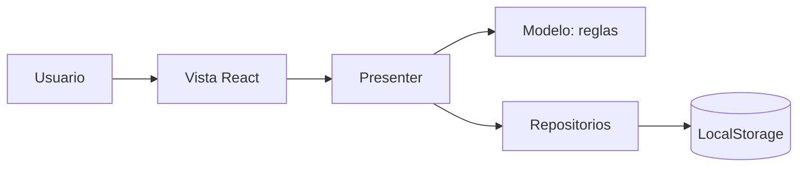

# Arquitectura MVP (Modelo–Vista–Presentador)

La vista muestra formularios. El Presenter coordina las acciones. El Modelo valida datos sin conocer React. El repositorio guarda y consulta los datos.
